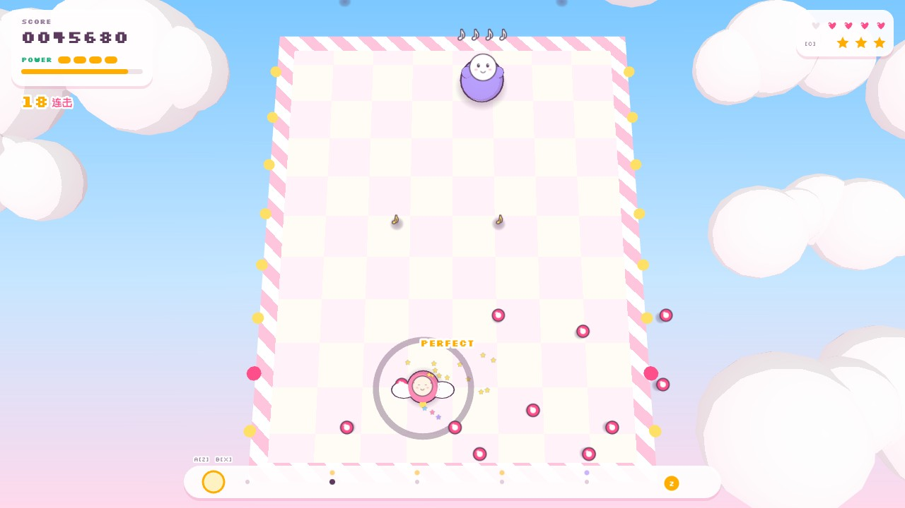

# 拍拍星航 PaPa Star Beat

节奏天国风格的可爱 3D 弹幕射击小游戏：粉彩云海上的棋盘舞台、描边卡通角色、所有动作都踩在拍子上。用 three.js 渲染的纯静态网页，可以直接部署到 GitHub Pages。

> 静默之王偷走了银河的节拍。驾驶小飞船「拍拍」，在拍子上开火，把节拍一首一首抢回来。

**在线游玩：<https://infinitytom.github.io/papa-star-beat/>**



试玩视频：[docs/trailer.mp4](docs/trailer.mp4)

## 玩法

- **鼠标移动**：小飞船跟着鼠标走（方向键也可以，按住 Shift 精细移动）；鼠标左键 = 射击，右键 = 弹反
- **A 键（默认 Z）射击**：踩在拍子上是 PERFECT 宽激光，不在拍上只有细弹，还会断连击
- **B 键（默认 X）弹反**：在拍上按 B 会张开护盾挡掉身边的子弹；鼓手的**重音弹**落地那一拍按 B 能弹回去，鼓面会挡住激光，所以鼓手只能靠弹反打倒
- **回声怪**：它先唱一小节，你在下一小节照着节奏回应。高音按 A，低音按 B，长音按住、唱完再松，按错键也算失误
- **长按**：射击键在拍上按下后一直按住，会变成持续激光，每个八分音符造成一次伤害
- **火力等级 Lv1–4**：PERFECT 充能，失误或受伤会掉级。Lv2 加两侧副炮，Lv3 激光变粗，Lv4 追加追踪音符弹；满级后继续充能会得到炸弹
- **敌人的攻击也踩拍**：无人机在拍上开火，子弹每拍向前冲一步；重音弹在固定的两拍后落地，地上会提前出现落点圈；底部节拍轨会提前显示要应答的音符和重音弹落地时间
- **炸弹（默认 C）**：清掉全屏子弹
- **所有按键都能在「设置」里改**，每个动作可以绑两个键

## 内容

- **每日演奏**：节拍回到银河以后，每天都有一场演奏会。4 首真实的免费歌曲，难度一天比一天高；标题页的「今日演奏」按日期轮换。关卡是从歌曲作者公开的 MIDI 里读出来的：回声怪唱的就是那一小节旋律的节奏（高音按 A、低音按 B、长音按住），无人机在军鼓 / 拍手上开火，鼓手跟着镲片砸下重音弹
- **教学故事** 4 章：节拍星港（射击）→ 鼓点星环（弹反）→ 切分霓虹（反拍）→ 合唱团长（Boss），音乐是实时合成的
- 3 种难度，判定窗口、血量、弹幕密度各不相同
- 排行榜：按「关卡 × 难度」分开排名
- 社区关卡：浏览、搜索、按最新 / 最热排序；每个关卡有分享链接 `?level=<id>`，打开直接进入

## 关卡编辑器

- **时间线**：每个小节一行，带 16 格迷你轨道，一眼看出音符、开火拍、鼓手、子弹墙在哪；回声后面的应答小节会标出来
- **点格编辑**：回声音符在 A / B 两行 16 分音符格子里点选，沿同一行拖动就是长按；无人机开火拍、鼓手发射拍、子弹墙发射拍也都是点格子
- **小节预览**：右上角小地图实时显示阵型、鼓手位置、回声怪 / Boss、子弹墙缺口
- **试听**：一键用当前 BPM 播放回声怪要唱的节奏
- **模板**：开场倒数、热身靶子、回声段、长音回声、踩拍弹幕、鼓手弹反、子弹墙、Boss 段，一键插入
- **检查**：实时提示常见问题（回声没有应答小节、应答小节里有攻击、同一拍两个音符、长音越界、Boss 没有能唱的回声……）
- **撤销 / 重做**（Ctrl+Z / Ctrl+Y），↑↓ 选择小节、Ctrl+D 复制、Del 删除；所有修改自动存草稿
- **剧情**：每行一句台词，旁边有角色头像参考
- **从任意小节试玩**，保存到「我的关卡」，导出 / 导入 JSON，上传到社区后得到分享链接

## 部署

纯静态文件，不需要构建。

1. 把整个目录推到 GitHub 仓库
2. 打开 Settings → Pages，选择分支和根目录
3. 本地预览：`python -m http.server`，然后打开 `http://localhost:8000`（双击打开 `index.html` 用不了 ES 模块）

three.js 通过 import map 从 jsDelivr 加载（固定版本 0.160.0）。

## 在线排行榜和社区关卡（Supabase，约 5 分钟）

不配置也能玩：排行榜会存在本机，关卡可以用 JSON 文件分享。

1. 在 [supabase.com](https://supabase.com) 新建一个项目（免费版就够）
2. 打开 SQL Editor，粘贴 `supabase/schema.sql` 的全部内容并运行
3. 在 Project Settings → API 复制 **Project URL** 和 **anon public** key
4. 填进 `js/config.js`：
   ```js
   export const SUPABASE_URL = 'https://xxxx.supabase.co';
   export const SUPABASE_ANON_KEY = 'eyJ...';
   ```
5. 推送到 GitHub。标题页显示「在线排行榜已连接」就说明成功了

anon key 本来就是公开的。数据库开启了行级安全：任何人都可以读、可以新增（有长度和数值范围检查），但不能修改或删除。分数是在客户端算的，懂技术的人可以伪造；如果以后排行榜要认真比，可以加上 Supabase Auth 和服务端校验。

## 音乐

**每日演奏**使用 [Tanner Helland](https://tannerhelland.com/music.html) 的免费音乐（[free-music](https://github.com/tannerhelland/free-music)，[CC BY 4.0](https://creativecommons.org/licenses/by/4.0/)），仅重新编码为 128kbps MP3，未改动内容：

| 天 | 曲目 | BPM |
|---|---|---|
| Day 1 · 蹑手蹑脚 | “Surreptitious” — Tanner Helland | 120 |
| Day 2 · 破晓 | “Daybreak” — Tanner Helland | 120 |
| Day 3 · 狂野水域 | “Wild Waters” — Tanner Helland | 115.2 |
| Day 4 · 小丑嘉年华 | “Clowns” — Tanner Helland | 120 |

谱面由 `tools/make_daily.py` 从同名 MIDI 自动生成（MIDI 给出精确的节拍网格，音频起点偏移用起音检测测量），想加歌可以照着改。

- 内置关卡的音乐是用 Web Audio 实时合成的（糖果芯片、星星流行、泡泡放克、团长进行曲四种风格，有鼓、贝斯、和弦、琶音和主旋律；回声小节会自动让出主旋律，方便听清怪物唱的节奏），节拍绝对准，也没有版权问题
- 关卡也可以用外部音频：在编辑器里把「音乐」改成「外部音频」，填好地址、BPM 和**首拍偏移**（音频里第 1 小节第 1 拍所在的秒数）
- 推荐把 CC0 / CC-BY 曲目放进仓库的 `music/` 目录，地址写成 `music/xxx.mp3`。同源访问不会有跨域问题。CC-BY 曲目要在「署名」里写清楚曲名、作者和协议
- 可以找公开授权曲目的地方：OpenGameArt（筛选 CC0）、FreePD、Free Music Archive（看每首曲子的许可）
- 编辑器的「用本机音频试听」可以直接载入本地文件来对拍，这个文件不会被上传
- 上传到社区的关卡，外部音频必须是可以公开访问的 https 地址

## 关卡格式

```jsonc
{
  "title": "我的关卡", "author": "我", "bpm": 120,
  "music": { "type": "synth", "style": "trance" },          // 或 { "type": "url", "url": "music/a.mp3", "offset": 0.12, "credit": "…" }
  "story": { "intro": [["metro", "台词"]], "outro": [] },   // 角色：pai metro drum boss sil
  "bars": [                                                 // 每个元素是一个 4 拍的小节
    { "lvl": 0, "text": "标题" },                           // lvl：音乐强度 0–3
    { "lvl": 2, "drones": { "n": 5, "form": "v", "fire": [1, 3], "aim": "aim", "life": 2, "hp": 2 } },
    { "lvl": 2, "echo": { "notes": [[0, "z", 0], [1, "x", 0], [2, "z", 1]] } },   // [拍位, 键, 长按拍数]
    { "lvl": 2, "drummer": { "x": 0.5, "fire": [0], "life": 4, "hp": 5 } },
    { "lvl": 2, "wall": { "rows": [0, 2], "gaps": [0.3, 0.7] } },
    { "lvl": 3, "bossIn": true }
  ],
  "boss": { "name": "BOSS", "hp": 300, "loop": [ { "lvl": 3, "echo": { "host": "boss", "notes": [[0, "z", 0]] } }, { "lvl": 3, "bossAtk": "spread" } ] }
}
```

回声小节的下一小节是应答小节，最好空着，或者只放不开火的敌人。

## 目录

```
index.html            页面与样式
js/main.js            界面、输入、剧情、结算
js/game.js            游戏逻辑（判定、敌人、子弹、火力、Boss）
js/render3d.js        three.js 场景、相机、卡通材质、粒子
js/hud.js             2D 覆盖层：分数、节拍轨、提示
js/audio.js           合成音乐、外部音频、节拍时钟、音效
js/levels.js          剧情、教学关卡、关卡校验
js/daily.js           每日演奏关卡（脚本生成）
music/                每日演奏的歌曲
tools/make_daily.py   从 MIDI 生成每日演奏谱面
js/editor.js          关卡编辑器
js/online.js          Supabase 排行榜 / 社区关卡，本地兜底
js/input.js           按键绑定
js/config.js          Supabase 配置
supabase/schema.sql   数据库建表与权限
assets/               赞赏码等图片
docs/                 试玩视频与截图
```

## 支持作者

拍拍星航免费游玩、开源发布。如果它让你笑了一下，欢迎自愿请作者喝杯奶茶（赞赏不会解锁任何内容）：


## License

代码以 MIT 协议开源。`music/` 里的歌曲版权归 Tanner Helland，以 CC BY 4.0 授权，详见 `music/CREDITS.md`。
